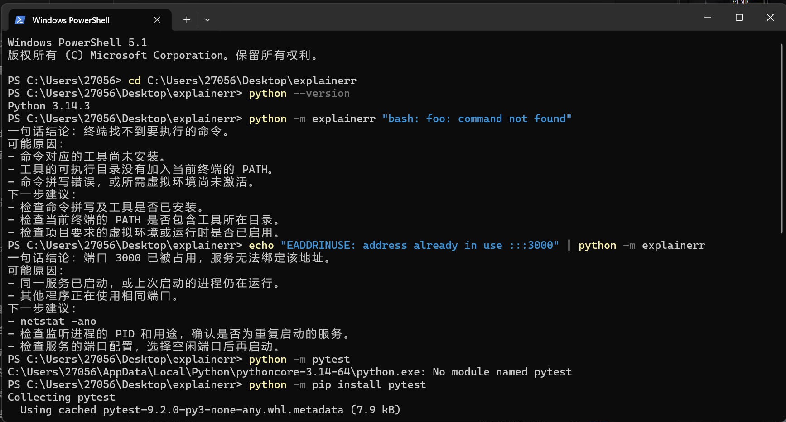

# 一个通过本地规则+LLM辅助，帮我解释报错并给出下一步建议的 CLI 工具

`explainerr` 用中文解释终端报错：一句话结论、最多 3 条可能原因、最多 3 条下一步建议。

默认使用本地规则，无需 API key。运行时只依赖 Python 标准库，要求 Python 3.11+。所有建议命令仅打印，由你检查后决定是否执行。

下面是 Windows PowerShell 中的实际运行效果，展示直接传入报错和通过 stdin 读取报错两种用法。



## 安装

在项目根目录执行：

```sh
python -m venv .venv
```

激活虚拟环境：

```sh
# macOS / Linux
source .venv/bin/activate
```

```powershell
# Windows PowerShell
.\.venv\Scripts\Activate.ps1
```

安装 CLI 和测试依赖：

```sh
python -m pip install -e ".[dev]"
```

仅使用 CLI 时可执行 `python -m pip install -e .`，不安装 pytest。未安装包时，在项目根目录也可直接使用 `python -m explainerr`。

如果 PowerShell 不允许激活脚本，可直接使用 `.\.venv\Scripts\python.exe` 和 `.\.venv\Scripts\explainerr.exe`。如果 `python` 指向不可用的 Windows 应用执行别名，请使用已安装的 Python 3.11+ 解释器的完整路径创建虚拟环境。

## 用法

```sh
explainerr "npm ERR! missing script: dev"
cat error.log | explainerr
explainerr --context "ModuleNotFoundError: No module named 'requests'"
python -m explainerr "bash: foo: command not found"
echo "EADDRINUSE: address already in use :::3000" | python -m explainerr
explainerr --help
explainerr --version
```

PowerShell 读取日志：

```powershell
Get-Content -Raw error.log | explainerr
```

报错以 `-` 开头时使用 `--` 分隔选项：

```sh
explainerr -- "--unexpected-option: command not found"
```

省略报错参数时从 stdin 读取，多行日志可以直接通过管道传入。参数和 stdin 同时存在时使用参数。报错输入超过 16000 字符会截断，并在 stderr 提示；空输入返回退出码 2。

## 输出示例

输入：

```sh
explainerr "npm ERR! missing script: dev"
```

输出：

```text
一句话结论：当前项目没有定义你要运行的 npm 脚本。
可能原因：
- package.json 的 scripts 中缺少该名称，或名称拼写不一致。
- 命令在错误的目录或工作区中执行。
下一步建议：
- npm run
- 检查 package.json 的 scripts 字段。
- 检查当前目录是否为目标项目根目录。
```

启用 `--context` 后，如果 `package.json` 的 `scripts` 可解析，还会列出其中已有的脚本名。端口占用规则在 Windows 建议 `netstat -ano`，在 macOS / Linux 建议使用 `lsof` 检查监听端口。

## 本地规则

| 报错类型 | 示例 |
| --- | --- |
| 命令缺失 | `command not found`、Windows 命令未识别 |
| 权限不足 | `Permission denied`、`EACCES`、`EPERM` |
| npm 脚本缺失 | `missing script: dev` |
| Python 模块缺失 | `ModuleNotFoundError: No module named 'requests'` |
| Python 名称导入失败 | `ImportError: cannot import name` |
| Node / 构建工具模块缺失 | `Cannot find module`、`ERR_MODULE_NOT_FOUND` |
| 端口占用 | `EADDRINUSE`、`Address already in use`、`WinError 10048` |

按具体类型优先匹配，整段日志输出一个解释。未命中的报错会明确说明无法确定原因，并给出通用检查项。本地规则不会猜测模块对应的安装包名，也不会推断所有项目的具体配置。

## 上下文与读取边界

默认不读取项目上下文。`--context` 仅从当前工作目录读取以下存在的文件：

- `package.json`
- `pyproject.toml`
- `requirements.txt`
- `README.md`

每个文件最多保留 4000 字符，四个文件合计最多 16000 字符；使用有界读取，不先加载整个文件。按 UTF-8 解码，非法字节替换为占位字符。缺失、无权限、非普通文件、符号链接、硬链接和 Windows 重解析点均跳过。不递归扫描，不读取 `.env`、密钥文件、`node_modules` 或 `.git`。

本地模式利用可解析的 `package.json` 补充 npm 脚本建议；其他白名单上下文用于可选 LLM 分析。截断导致 JSON 不完整时跳过脚本解析，仍输出本地解释。

## 可选 LLM 模式

只有 `OPENAI_API_KEY` 非空且 `EXPLAINERR_USE_LLM=1` 时才调用 API，其余情况全部使用本地规则，不发送网络请求。

```sh
export OPENAI_API_KEY="你的 API key"
export EXPLAINERR_USE_LLM=1
explainerr --context "npm ERR! missing script: dev"
```

PowerShell：

```powershell
$env:OPENAI_API_KEY = "你的 API key"
$env:EXPLAINERR_USE_LLM = "1"
explainerr --context "npm ERR! missing script: dev"
```

| 环境变量 | 默认值 | 说明 |
| --- | --- | --- |
| `OPENAI_API_KEY` | 未设置 | API 密钥；空值或仅空白不启用 LLM |
| `EXPLAINERR_USE_LLM` | 未设置 | 必须设为 `1` 才启用 LLM |
| `OPENAI_BASE_URL` | `https://api.openai.com/v1` | 兼容服务的 API 根地址；自动追加 `/chat/completions` |
| `OPENAI_MODEL` | `gpt-4o-mini` | 服务提供的模型名；兼容服务应填写其支持的模型 |
| `EXPLAINERR_TIMEOUT` | `15` | 网络操作超时秒数，大于 0 且不超过 60；不是整个请求的严格总时限 |

通过标准库 `urllib` 发送 Chat Completions 请求，接口格式参考 [OpenAI API 文档](https://developers.openai.com/api/reference/resources/chat)。兼容地址例如 `https://your-provider.example/v1` 或本机服务 `http://localhost:8000/v1`；远程服务应使用 HTTPS。API 根地址不能带用户名、密码、查询参数或 URL 片段；不接受重定向。

请求只包含模型名和消息，不要求服务支持 JSON schema 参数。服务需要返回 JSON 解释，程序在本地校验字段、条目数量和中文结论/原因，并统一为固定格式。建议中的命令可包含英文命令名。

超时、网络错误、HTTP 错误、错误配置、超大响应、非 JSON 响应或不合格输出都会自动回退到本地规则。失败提示写入 stderr，不打印异常详情、API key 或响应正文；stdout 保持三段格式，解释成功退出码为 0。中断退出码为 130。

启用 LLM 时，报错文本会发送给配置的 API 服务；同时使用 `--context` 时，截断后的白名单文件内容也会发送。程序不自动脱敏这些文本，传入前应检查其中是否包含密钥。本地模式无需网络。程序不加载 `.env`，环境变量需要由终端或调用方设置。

## 验证

安装开发依赖并激活虚拟环境后执行：

```sh
python -m explainerr "bash: foo: command not found"
echo "EADDRINUSE: address already in use :::3000" | python -m explainerr
python -m explainerr --context "ModuleNotFoundError: No module named 'requests'"
pytest
```

也可以使用 `python -m pytest`。测试使用临时目录和模拟 HTTP 响应，不需要真实 API key，也不访问外部 API。覆盖规则分类、参数/stdin、空输入、截断、上下文白名单、链接跳过、输出格式、LLM 正常响应和失败回退，以及不执行命令、不改写上下文文件。

## 项目结构

```text
explainerr/
  __init__.py       版本
  __main__.py       python -m explainerr 入口
  cli.py            参数、stdin、模式选择
  models.py         输出约束和渲染
  rules.py          本地规则
  context.py        受限上下文读取
  llm.py            可选兼容 API 客户端
tests/              pytest 测试
pyproject.toml      打包、CLI 命令和开发依赖
```

MVP 不包含网页、数据库、shell hook、插件系统、自动执行修复命令或自动改写项目文件。输出语言仅中文。
